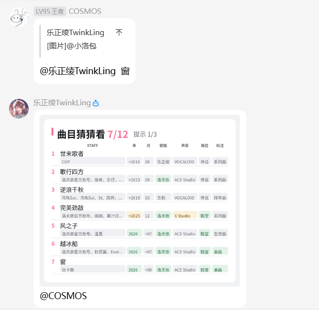
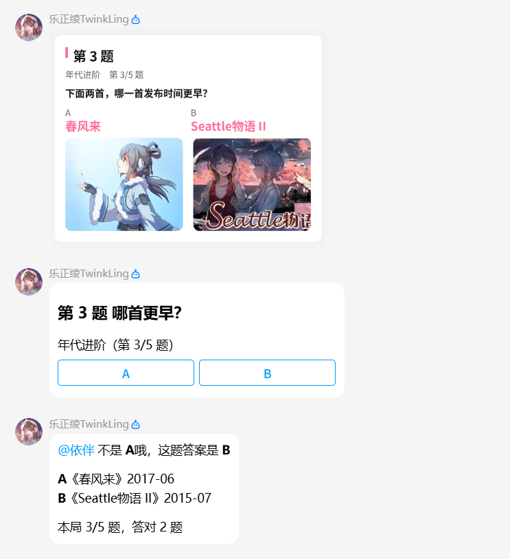
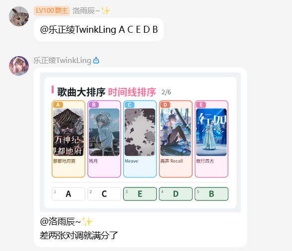
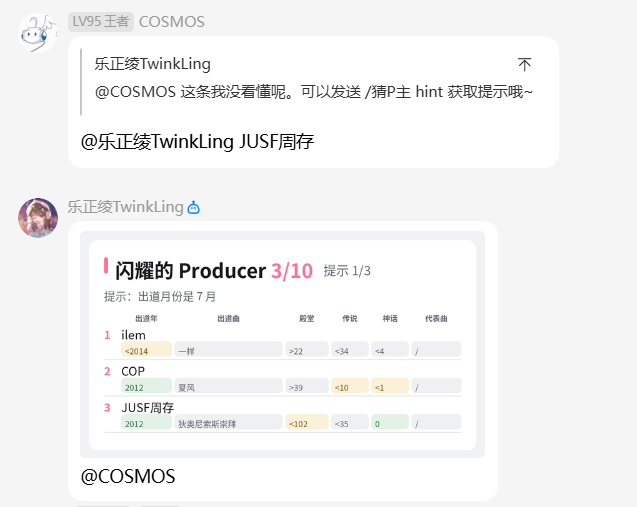
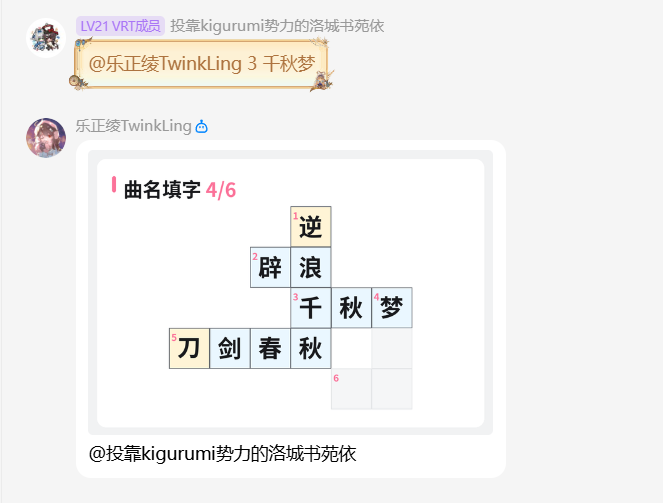
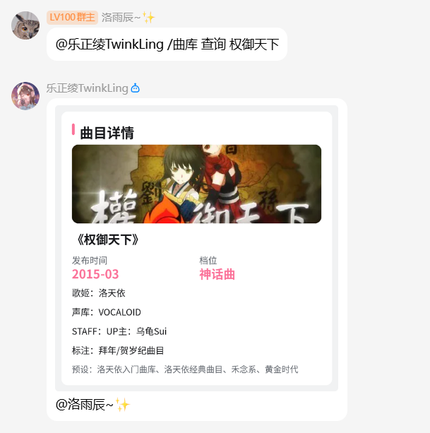

曲库数据来源：[VCPedia.cn - 中文歌声合成个人收集站](https://vcpedia.cn)

:::info
同一个群里同一种玩法同时只能开一局。
:::

## 1 曲目猜猜看

根据线索，猜出答案歌曲。

bot 会在目标曲库里随机抽一首歌。发送作答后，bot 会把你猜的这首歌和答案逐项对比，并返回制作人员（STAFF）、发布年、发布月、歌姬、声库、档位、标注这七项的对应情况。

共 12 次机会。

- `/曲目猜猜看`：用默认曲库开始游戏。
- `/曲目猜猜看 hint`：获得下一级提示。提示一共三级，每 3 次会给出一级提示。
- `/曲目猜猜看 stop`：结束游戏并公布答案。

## 谁是老资历

判断两首歌里哪一首发布得更早。

每道题有两首歌，请判断哪一首是发布更早的歌曲。每题只接收群里最先发出作答，并会立刻公布答案，隔 4 秒再出下一题。可在对局里发送 A 或者 B 作答，或者点击按钮作答。

共 5 道题。

- `/谁是老资历`：开始游戏，默认 5 道题。
- `/谁是老资历 10`：开始游戏，共 10 道题，题数可以写 1 ~ 20。
- `/谁是老资历 stop`：结束游戏并公布答案。

## 歌曲大排序

把打乱的 5 首歌按发布时间进行排序。

默认按发布时间进行排列。作答时，请将答案写成 A 到 E 的一个排列，比如 `A C B D E`；每次提交，bot 会发送一张图片，把放置正确的位置刷绿。

共 6 次机会。

- `/歌曲大排序`：按发布时间开一局。
- `/歌曲大排序 年份`：只比较年份，不比较月份。
- `/歌曲大排序 stop`：结束游戏并公布答案。

## 猜P主

根据线索，猜出目标 P 主。

bot 会随机抽一名 P 主。发送作答后，bot 会返回名字、出道年、出道曲、殿堂曲数、传说曲数、神话曲数的对应情况。

- `/猜P主`：只从名 P 里出题。
- `/猜P主 全`：在所有 P 主中出题。
- `/猜P主 hint`：获得下一级提示，一共 3 级。
- `/猜P主 stop`：结束游戏并公布答案。

## 曲名填字

根据线索补全曲名。

一个字池和 6 条线索，按编号作答，比如 `1 春风来`。

共 12 次机会。曲名填字不提供筛选档位的曲库选择。

- `/曲名填字`：用默认曲库开始游戏。
- `/曲名填字 字池`：重新查看字池和还没解开的条目。
- `/曲名填字 stop`：结束游戏并公布全部答案。

## 曲库

曲目猜猜看、谁是老资历、歌曲大排序，可以在命令后面接曲库名和档位，比如：

- `/曲目猜猜看 洛天依`：表示选择**洛天依**唱的**所有曲目**。
- `/曲目猜猜看 洛天依 传说及以上`：表示选择**洛天依**唱的**传说曲**和**神话曲**。

### /曲库 

查看曲库里有哪些预设、哪些歌姬、哪些档位，以及各自有多少首歌。

- `/曲库`：列出全部曲库
- `/曲库 洛天依`：查看洛天依这一个曲库有多少首
- `/曲库 传说及以上`：查看这一档有多少首

### /曲库 查询

查询一首歌的详细信息，包含封面（没有封面的歌用占位图）、发布时间、档位、歌姬、声库、制作人员（STAFF）、标注，以及属于哪些曲库、会不会出现在题目里。曲名填写一半与填写拼音均可正常查询。

- `/曲库 查询 权御天下` 查询《权御天下》的歌曲信息。

