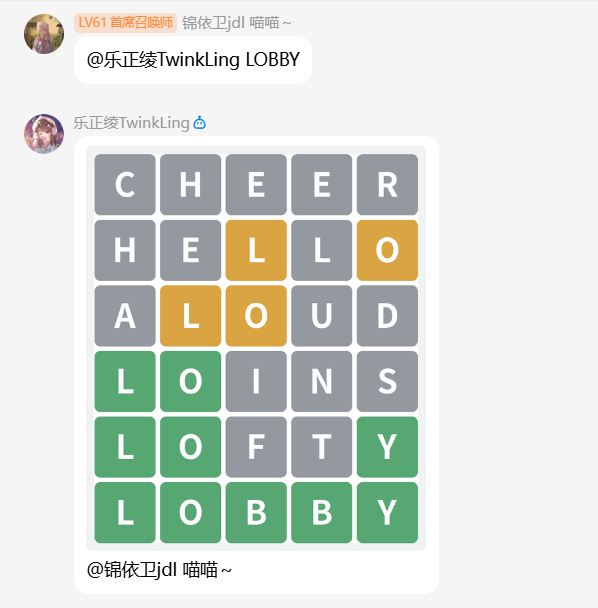

Wordle 猜词游戏：

每猜一个词，字母会按颜色提示对错：绿色表示这个字母的位置对了，黄色表示这个字母在答案里但位置不对，灰色表示答案里没有这个字母。

- `/猜单词`：5 阶猜词游戏
- `/猜单词 6`：6 阶猜词游戏，长度可以写 4 到 7
- `/猜单词 hint`：获取，一局只能获取一次。
- `/猜单词 stop`：结束游戏并公布答案。
- `/猜单词 dict`：查看词库列表，加上编号可以更换词库。

